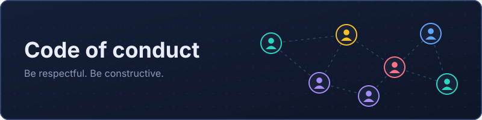

  

# Code of Conduct

This code of conduct is adapted from the [Contributor Covenant](https://www.contributor-covenant.org), version 2.1.

## Our pledge

We want participation in Vendora to be a harassment-free experience for everyone, regardless of age, body size, disability, ethnicity, gender identity and expression, level of experience, education, nationality, personal appearance, race, religion, or sexual identity and orientation.

## Our standards

Behavior that contributes to a positive environment:

- Being respectful and patient with different viewpoints and experience levels
- Giving and accepting constructive feedback gracefully
- Taking responsibility for mistakes and learning from them
- Focusing on what is best for the project and its community

Behavior that is not acceptable:

- Sexualized language or imagery, and unwelcome sexual attention
- Trolling, insulting or derogatory comments, and personal or political attacks
- Public or private harassment
- Publishing others' private information without their permission
- Other conduct that could reasonably be considered inappropriate in a professional setting

## Enforcement responsibilities

Project maintainers are responsible for clarifying and enforcing these standards. They may remove, edit, or reject comments, commits, code, issues, and other contributions that do not follow this code of conduct, and will explain the reason when appropriate.

## Scope

This code of conduct applies in all project spaces (issues, pull requests, discussions) and when an individual is representing the project in public.

## Reporting

Report unacceptable behavior to the maintainer at **meriemachh5@gmail.com**. All reports are reviewed promptly and handled with respect for the privacy of the reporter.

## Enforcement guidelines

Maintainers follow these steps, depending on the impact of the behavior:

1. **Correction.** A private note explaining the problem and what was inappropriate. A public apology may be requested.
2. **Warning.** A warning with consequences for continued behavior, and no interaction with the people involved for a set period.
3. **Temporary ban.** A temporary ban from the project's spaces for a set period.
4. **Permanent ban.** A permanent ban for a pattern of violations, harassment, or aggression toward individuals or groups.

## Attribution

Adapted from the [Contributor Covenant](https://www.contributor-covenant.org/version/2/1/code_of_conduct.html), version 2.1, which is available under the [CC BY 4.0 license](https://creativecommons.org/licenses/by/4.0/).
