<p align="center">
  
</p>

<h3 align="center">Procurement investigations done by AI agents. Decided by people.</h3>

<p align="center">
  OCR tools read invoices. Vendora works out why an invoice disagrees with its purchase order and contract,
  shows the evidence, and holds the payment until a person decides.
</p>

<p align="center">
  
  
  
  
  
  
<a href="https://github.com/achh-914/VENDORA/actions/workflows/ci.yml"></a>
</p>

---

## The problem

A company receives an invoice. Three documents disagree:

| Document | What it says |
|---|---|
| Invoice | **$18,000**, with a freight line |
| Purchase order | **$15,000**, no freight line |
| Contract | Different pricing rules, and a clause about delivery costs |

*(Illustrative numbers.)*

An analyst opens all three, finds the $3,000 gap, works out why, writes to the supplier, and blocks payment in the meantime. This happens thousands of times a year, and every case is slow and easy to get wrong.

Vendora does the investigation and hands the analyst a **case file**: what differs, why, which page and clause prove it, and what to do next.

---

## What Vendora does

| Capability | Question it answers | Status |
|---|---|---|
- [x] **M1: Extraction.** Structured extraction from invoice, PO and contract, with page references (tested with a mocked model, first real run pending)
- [x] **M2: Matching.** Invoice vs PO comparison: price, quantity, duplicate and unagreed-fee detection
| **Investigate** | Why, and which line or clause proves it? | Done (M3) |
| **Resolve** | What is the safest next step? | Done (M3) |
| **Escalate** | Has a person approved it? | Planned (M5) |
| **Audit** | Who decided what, based on which evidence? | Planned (M1 onward) |
| **Evaluate** | How often is the system right? | Planned (M4) |

---

## Architecture

<p align="center">
  
</p>

> The diagram shows the target design. Solid boxes are the MVP, dashed boxes are planned. The animation follows one invoice through the pipeline and holds it at the human approval step. See the [Roadmap](#roadmap) for what exists today.

**Why a fixed workflow first.** The MVP runs Matching, then Investigation, then Supervisor, in that order. Dynamic routing (letting the system choose which agent acts) comes after the fixed version is measured and works.

---

## Example: one case, end to end

1. **Extract.** Pull totals, line items and terms from the invoice, PO and contract, keeping the page of each value.
2. **Match.** Compare the three. Flag the freight line that appears on the invoice only.
3. **Investigate.** Search the contract. Find the delivery clause that says freight is included in the unit price.
4. **Supervise.** Check that every claim has evidence. Hold the invoice and attach a draft message to the supplier.
5. **Decide.** A person approves, rejects, or asks for changes. Every step is logged.

Target output (illustrative):

```json
{
  "case_id": "CASE-0001",
  "finding": "UNAGREED-FEE",
  "delta": 3000.00,
  "evidence": [
    { "doc": "invoice.pdf",  "page": 1, "ref": "line 4: Freight surcharge, $3,000" },
    { "doc": "po-4471.pdf",  "page": 1, "ref": "no freight line, total $15,000" },
    { "doc": "contract.pdf", "page": 6, "ref": "clause 4.2: freight included in unit price" }
  ],
  "proposed_action": ["HOLD_INVOICE", "DRAFT_SUPPLIER_MESSAGE"],
  "requires_human_approval": true
}
```

---

## Discrepancy types

These are the categories the evaluation set is built around.

| Tag | What it detects |
|---|---|
| `PRICE-MISMATCH` | Invoice total or unit price differs from the PO |
| `UNAGREED-FEE` | A charge (freight, handling, surcharge) that is not in the PO or contract |
| `QTY-VARIANCE` | Billed quantity differs from the quantity ordered or received |
| `DUPLICATE-LINE` | The same line item billed twice |
| `TERMS-CONFLICT` | Payment terms or pricing rules contradict the contract |

---

## Terminal preview

Illustrative target experience. Not implemented yet.

```text
$ vendora analyze --invoice inv-2041.pdf --po po-4471.pdf --contract msa-acme.pdf
✔ Extracted 3 documents, 27 fields
✖ 1 discrepancy: UNAGREED-FEE ($3,000.00)
    invoice     p.1  line 4      "Freight surcharge"
    po-4471     p.1              no freight line
    contract    p.6  clause 4.2  freight included in unit price
! Invoice held. Supplier message drafted. Waiting for approval.
```

---

## Quick start

> Extraction (M1) works today. The rest is planned.

```bash
git clone https://github.com/achh-914/VENDORA.git
cd VENDORA
cp .env.example .env        # add GEMINI_API_KEY
docker compose up -d        # PostgreSQL with pgvector
pip install -e ".[dev]"
python -m app.agents.extraction data/samples/inv-2041.pdf
```


---

## Design principles

- **A person decides about money.** Vendora proposes. It never approves or pays on its own.
- **Evidence or it did not happen.** Every conclusion points to a document, page and clause.
- **Simulated actions by default.** Holding an invoice or emailing a supplier is simulated in the MVP.
- **Fixed before dynamic.** Get one workflow right and measured before adding routing.
- **Measured, not assumed.** Quality is scored against cases with known answers.

---

## Evaluation

Cases are synthetic documents with deliberate errors, so each one has a known correct answer.

**Matching and investigation** (offline, no LLM): 80 generated cases (40 basic, 40 hard), fixed seed. The run is part of the test suite, so a regression fails CI.

**Extraction** (real model): the three sample PDFs, scored field by field.

| Metric                                      | Result                           |
|---------------------------------------------|----------------------------------|
| Detection, basic cases (5 error types)      | 40/40 (100%)                     |
| Detection, hard cases                       | 40/40 (100%)                     |
| Amount (delta) accuracy                     | 64/64 (100%)                     |
| Fee clause citation (clause 4.2, page 2)    | 32/32 (100%)                     |
| Case files requiring human approval         | 32/32 (100%)                     |
| Extraction accuracy (3 PDFs, 26 fields)     | 26/26 (100%), Gemini `<MODEL>`   |
| Cost per case                               | $0.00 (offline matching, free tier extraction) |

Hard matching cases cover several errors in one invoice, two unagreed fees, shuffled line order, agreed fees that must not be flagged, and decimal rounding.

**Read this carefully.** These are small, clean, synthetic inputs, and the extraction score comes from a single run on three text PDFs (one request needed a retry after a temporary server error). It shows the pipeline works end to end. It does not show real-world accuracy. Scanned documents, other layouts and languages are not covered, and Gemini is the default provider and the one that was scored. Claude is supported (set VENDORA_PROVIDER=claude) but has not been scored yet.

Run it yourself: `python eval/run_eval.py` (matching) and `python eval/run_extraction_eval.py` (extraction, needs an API key).

---

## Roadmap

- [x] **M1: Extraction.** Structured extraction from invoice, PO and contract, with page references (scored on 3 synthetic PDFs with Gemini)
- [x] **M2: Matching.** Cross-document comparison and discrepancy detection
- [x] **M3: Investigation.** Root cause with cited evidence, proposed resolution, audit log
- [x] **M4: Evaluation.** 80 synthetic cases and automated scoring in CI, plus a field-level extraction score
- [ ] **M5: Demo.** Review dashboard with the human approval flow and audit view
- [ ] **Later:** Negotiation agent, compliance rules, dynamic routing, exports

---

## Project structure

```
vendora/
├── app/
│   ├── main.py         FastAPI application
│   ├── schemas.py      case file and discrepancy models
│   └── agents/         extraction, matching
├── data/samples/       synthetic invoice, PO and contract
├── tests/              unit tests (run in CI)
├── db/                 migrations and schemas
├── docs/               design notes and assets
├── docker-compose.yml
└── .env.example
```

---

## Scope and limitations

- Early-stage project, not production-ready.
- Synthetic documents only. No real company data.
- Actions are simulated. Nothing is sent, held or paid.

## Contributing

Feedback and ideas are welcome. Open an issue before proposing larger changes.

## License

Released under the [MIT License](LICENSE).
